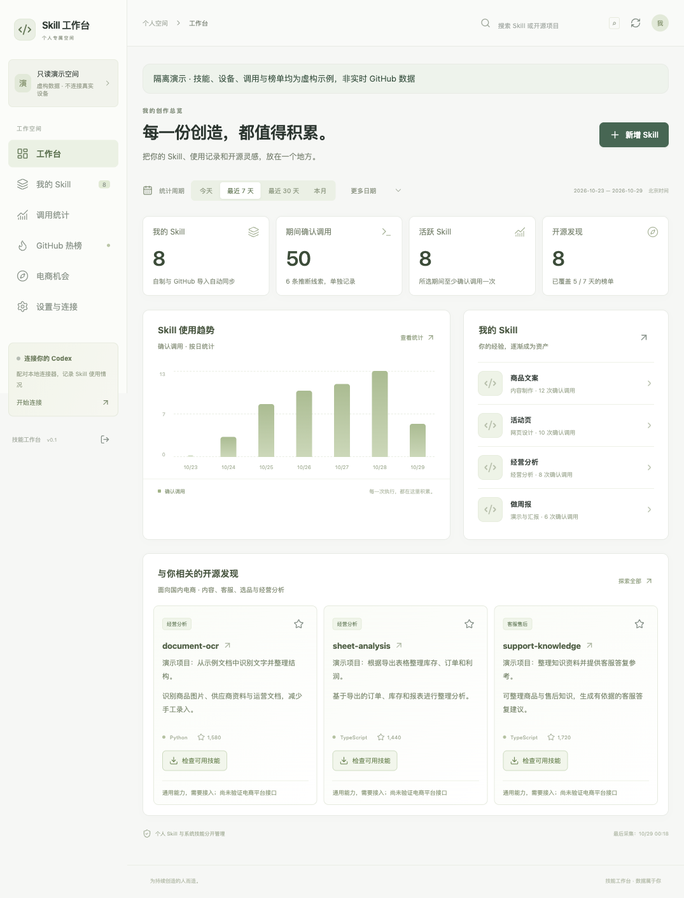
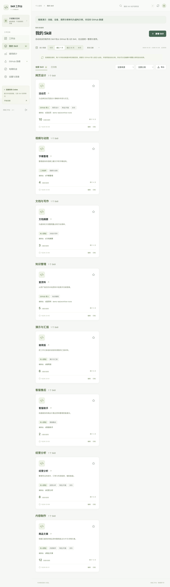
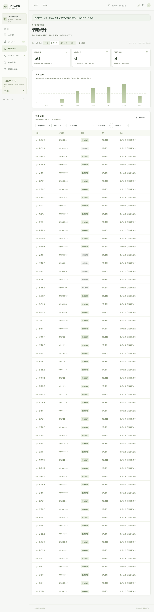
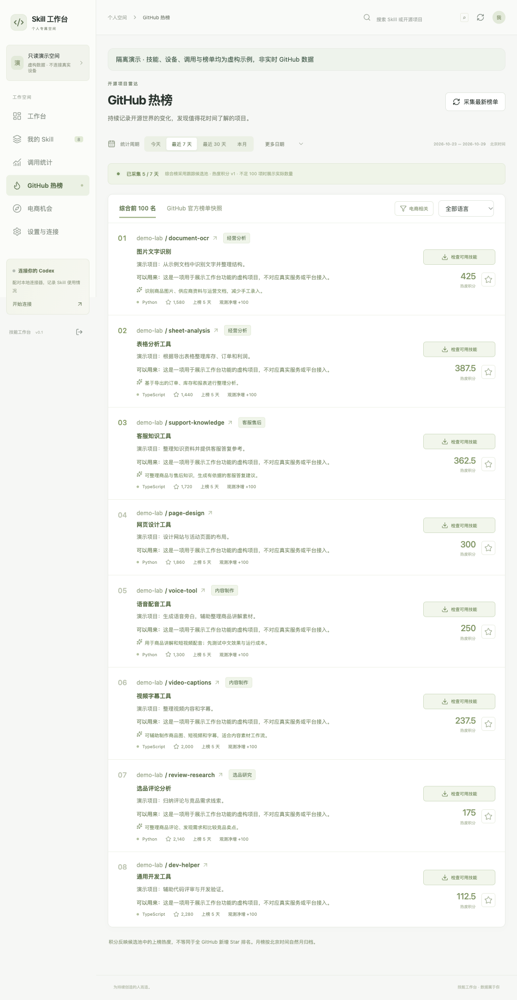
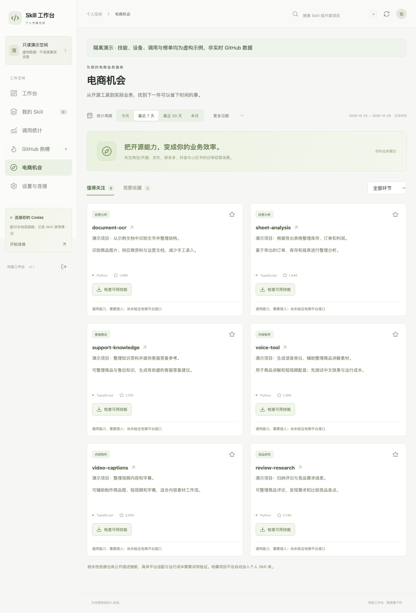
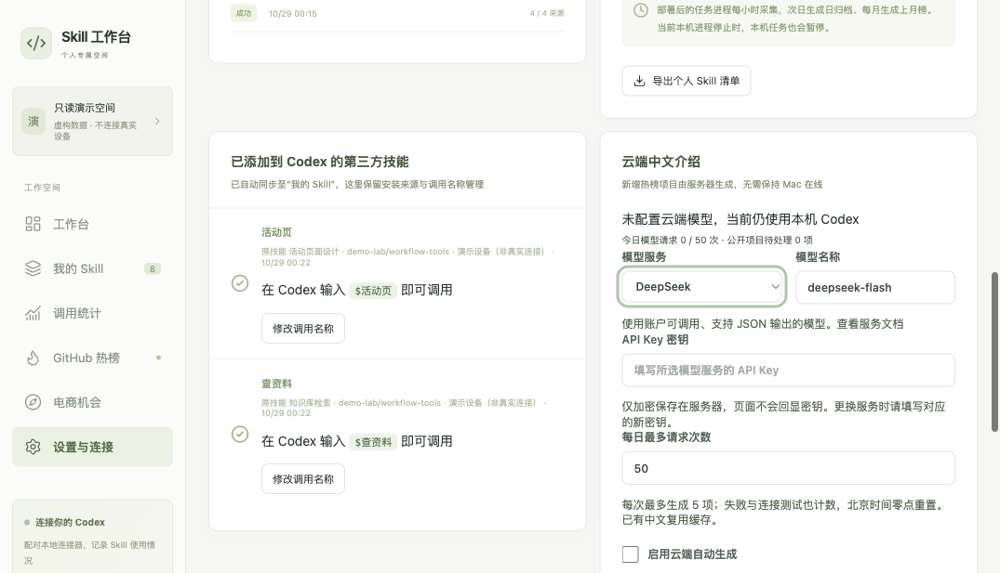

# Skill 工作台 · Skill Workbench

把个人创作的 Skill、从 GitHub 导入的 Skill、调用记录和开源项目热榜，放进同一个中文工作台。

你可以按用途整理技能，为常用技能设置好记的中文启动名称，按日期了解明确调用情况，再从 GitHub 热榜发现值得尝试的工具。网页可以部署到服务器，多台设备共用一个入口；技能发现、安装和本机调用记录由主动连接的本地连接器负责。

**适合已经开始用 AI 做事、希望把自己的方法积累为可复用技能的人。** 项目提供可自行部署的源码，不需要注册本项目的云账户。

[快速开始](#快速开始) · [界面预览](#界面预览) · [连接-codex](#连接-codex) · [榜单口径](#github-榜单的数据来源和口径) · [部署](#部署到服务器) · [常见问题](#常见问题)

## 能做什么

| 功能 | 当前实现 |
|---|---|
| 个人 Skill 库 | 统一整理原创、二次创作、本地新增与 GitHub 导入的 Skill；系统技能和插件缓存不作为个人技能收录。 |
| 自动分类与检索 | 根据名称、用途、来源和标签判断分类；按分类分组，支持搜索、收藏、归档及手动整理。手工修改在同步时保留。 |
| 自定义启动名称 | 分别编辑网页显示名和 Codex 启动名；连接器创建独立调用别名，原技能及相对资源保留。 |
| 日期调用统计 | 今天、昨天、近7天、近30天、自然月、指定月份和自定义日期；确认调用与推断线索分别展示。 |
| GitHub 热榜 | 20个语言/全语言日榜来源，另存全语言周榜、月榜快照；聚合日榜形成多周期最多100项的综合榜。 |
| 中文用途说明 | 中文标题、简介和用途按原始描述版本缓存；可选择本机 Codex 或配置云端模型 API 生成。 |
| 电商用途提示 | 识别内容制作、配音、文档解析、客服知识、选品研究、报表分析等潜在用途，并提示接入与验证边界。 |
| 技能安装与合集导入 | 检查真实 `SKILL.md` 清单，选择电脑、单个或多个技能及自定义名称，交由本机连接器安装。 |
| 本机连接器 | 主动同步、一次性配对、设备撤销、本地离线队列、事件去重、安装与改名结果回传。 |
| 数据保留 | 技能版本、真实榜单快照、日/月归档、CSV导出；提供 SQLite/PostgreSQL 适配和备份命令。 |

## 对不同工作者有什么帮助

| 使用者 | 可以怎样用 |
|---|---|
| 电商运营 | 把商品文案、评论整理、经营报表、客服知识等技能归档；给常用技能起“商品文案”“经营分析”等启动名；从开源项目中寻找素材或数据处理工具，再结合自己的导出资料验证。 |
| 内容创作者 | 管理文章、配音、视频字幕和演示技能；按主题检索已有方法，查看近期明确调用记录，沉淀常用工作流。 |
| 产品经理与设计师 | 分类保存网页设计、研究、评审、原型和汇报技能；用统一入口查找来源、用途与版本，减少“装过但找不到”的情况。 |
| 开发者 | 管理编码、测试、调试和自动化技能；区分显式唤起和文件读取证据；从真实清单按需安装，保留原项目来源。 |
| 行政、分析与普通办公人员 | 整理文档摘要、表格处理、知识检索、会议或周报技能；使用中文名称调用，按日期回看自己的使用情况。 |

这些是工作流用法，不是业务成效承诺。项目没有内置淘宝、天猫、京东、拼多多、抖音或小红书的经营账号接入，也不会自动获取店铺数据；电商提示是基于公开元数据的规则判断，需自行验证工具质量、权限、依赖与实际用途。

## 界面预览

以下六张图均由**真实运行的工作台页面**拍摄，使用仓库提供的隔离只读演示库。技能、设备、调用与榜单都是明确标注的虚构示例，不含个人数据，也不是实时 GitHub 排名或真实业务成绩。可以用 `pnpm demo` 在本机复现这些页面。

### 1. 工作台总览

从近期调用、技能分类和开源项目入口开始一天的工作。



### 2. 我的 Skill

按用途分组，查看来源、启动名称、近期调用和整理入口。



### 3. 调用统计

按日期查看明确调用与推断线索；“明确唤起”不等于执行成功。



### 4. GitHub 热榜

在同一页面切换周期、看中文用途和真实采集覆盖情况。演示图只有8个虚构项目；真实采集时按实际数量展示，最多100项。



### 5. 电商机会

把公开项目的通用能力映射为可验证的工作流线索，并保留“尚未验证平台接口”的提示。



### 6. 设置与连接

查看设备连接、采集状态和安装记录。云端中文介绍默认关闭，需要自行配置模型 API；配对码、密钥和私人设备信息没有出现在截图中。



## 系统要求

- **Node.js 24 或更新版本**：使用内置 `node:sqlite`，旧版 Node 不适用。
- **pnpm 11.25.0**：仓库保留 `pnpm-lock.yaml` 和允许构建的依赖声明。
- **Git**：用于仓库/技能目录检查和固定提交的技能安装。
- 网页/API 的主要验收环境为 macOS + Node 24 + SQLite。
- 本机连接器已在 macOS 验证；macOS 设备令牌存入钥匙串。其他系统使用权限受限的本地令牌文件，但其 Codex 历史格式和完整连接器流程仍需自行验证。
- Docker Compose/PostgreSQL 部署配置已提供；本次公开版本未在独立 PostgreSQL 服务器完成端到端验收。

## 快速开始

```sh
git clone https://github.com/jinxiaoai2026/skill-workbench.git
cd skill-workbench

# 如果系统还没有 pnpm，可通过 npm 安装固定版本：
npm install --global pnpm@11.25.0

pnpm install --frozen-lockfile
pnpm build

# macOS / Linux：启动网页、采集与归档任务；默认不调用本机 Codex 生成中文。
sh scripts/workbench start
```

打开 **http://127.0.0.1:4317**。请使用这个完整地址，不要与 `localhost` 混用；认证写入请求检查实际 Origin。

启动脚本只使用标准 PATH 中的 Node/pnpm/Corepack，**不依赖 Codex 自带运行时、作者电脑路径或已登录账户**。也可直接启动：

```sh
RUN_WORKER=1 EXPLAIN_WITH_CODEX=0 pnpm start
```

Windows PowerShell 可分别设置 `$env:RUN_WORKER="1"`、`$env:EXPLAIN_WITH_CODEX="0"`，再运行 `pnpm start`；该平台未完成本文全部验收。

### 首次登录和数据目录

- 管理员账户：`admin`。
- 首次随机密码写在启动目录下的 **`.local/admin-credentials.json`**，查看其中的 `password` 字段。该文件不会进入 Git，服务不会把密码打印到日志。
- 首次数据库为空，没有预装作者的 Skill、设备、调用、密钥或热榜历史。
- 登录后可在设置中修改密码。后续有效密码以数据库中的散列为准，初始密码文件不是密码修改后的实时备份。
- `.local/` 保存你自己的数据库、初始凭证及缓存，请保护并备份，不要上传到 GitHub。
- `WORKBENCH_DATA_DIR` 可指定其他私有数据目录；本机启动命令不会自动读取 `.env` 文件，需通过系统环境变量传入。

初次热榜采集会访问 GitHub，网络不通时保留空库或上次有效结果，界面显示缺口。新实例不会凭空拥有此前30天的历史。

### 只想先看界面

```sh
pnpm build
pnpm demo
```

打开 **http://127.0.0.1:4325**。管理员账户仍为 `admin`，演示随机密码单独位于 `.local/demo/admin-credentials.json`。演示服务器只监听本机，使用独立 `.local/demo/` 数据库，不扫描真实技能或聊天记录；采集、安装、配对、模型请求和修改功能禁用。非空的非演示数据库会被拒绝，不覆盖已有内容。

演示用来理解界面，正常使用请运行前面的 `start`，不要把演示数据库当作个人工作数据。

## 连接 Codex

在运行 Codex 的电脑上准备本仓库的 Node/pnpm 依赖。网页与连接器可以在同一台电脑，也可以网页在服务器、连接器在本机。

1. 登录网页，在“设置与连接”生成一次性配对码。
2. 在本机终端执行配对；使用网页实际的 HTTPS 地址和一次性码。
3. 持续运行连接器，或自行用操作系统的后台服务管理器保持运行。

```sh
# 本机同机连接示例
pnpm connector pair http://127.0.0.1:4317 一次性配对码
pnpm connector list
pnpm connector watch

# 服务器示例；远程地址必须是 HTTPS
pnpm connector pair https://skills.example.com 一次性配对码
```

如果这台电脑已有其他工作台连接器，请先设置独立的 `WORKBENCH_CONNECTOR_DIR` 后再配对，避免改动原有配对配置。不要同时让多个进程操作同一连接器目录。

连接器约每15秒发现技能并同步；目录检查任务约每3秒领取。它只主动连出，不需要向公网开放电脑端口。

默认检查 `~/.agents/skills`、`$CODEX_HOME/skills`（缺省为 `~/.codex/skills`）、当前项目 `.agents/skills` 及配置的安装目录。系统 `.system` 目录、插件缓存和工作台生成的调用别名不作为独立个人 Skill。其他目录可显式加入：

```sh
pnpm connector roots /绝对路径/项目/.agents/skills /绝对路径/我的技能
```

无法确认作者的本地技能先标为“本地新增”；可以在网页更正，或手动登记原创归属：

```sh
pnpm connector adopt /绝对路径/my-skill --ownership original
# 二次创作用 derived；已有网页记录可加 --id 对应的Skill-ID，避免重复登记。
```

默认同步名称、用途、版本、来源与最小调用证据，**不上传聊天正文、附属素材或本地绝对路径**。需要在网页查看 `SKILL.md` 正文时，仅对你愿意同步的技能在登记时加 `--sync-content`。详见 [隐私与安全](PRIVACY.md)。

### 自定义中文启动名称

进入“我的 Skill → 编辑 → 启动名称（Codex）”，设置例如“活动页”。连接器完成本地别名写入后，界面才显示同步成功。

```text
使用 $活动页 为这次活动整理页面方案
```

显示名和启动名是两个字段。启动名支持1–64个中文、英文字母、数字、短横线或下划线，不含空格；不能与其他技能重名。新别名通常在下一轮 Codex 对话可用，必要时重启 Codex。

别名指向原技能目录，原文件和相对资源保留。连接器离线时改名任务等待；本地修改、来源变化或重名时会提示冲突，不覆盖用户内容。

### 调用次数到底记录了什么

- 在 Codex 用户消息中明确输入 `$原名` 或 `$自定义名`，计为确认的“直接唤起”；同一轮同一 Skill 只计一次，原名和别名归到同一技能。
- 普通提及、示例代码、转义文字不自动当作明确调用。只有读取技能指令的线索时单列为“推断”。
- 明确唤起表示发起请求，执行结果保持未知，不能据此宣称任务成功。
- 如果需要实际进程结果，可以使用受管入口：

```sh
pnpm connector run <skill-id> -- python3 /你的技能目录/scripts/run.py
```

该入口记录开始、成功/失败/取消，并将命令退出码返回给终端；与 Skill 无关的命令不要包进统计。当前已验证的原生历史格式是 `thread_history_1.sqlite`；未来 Codex 版本可能变化。不保证隐式调用全部可见，也不会自动回填启用前的对话。

## 从 GitHub 添加 Skill

在热榜或开源发现页点击“检查可用技能 / 添加到 Codex”。工作台先读取固定提交的真实技能清单，再让你选择要装的条目、目标电脑和启动名。

- 多技能仓库支持跨搜索和分页勾选、全选和批量导入，单次最多300项；失败项可单独重试。
- 普通软件仓库不因上榜就变成可安装 Skill；无法找到真实清单时会显示检查结果。
- 目录预检和安装优先用受限 Git，只读所需清单/所选目录；不必下载整个仓库归档。
- GitHub 元数据查询与热榜补充共享请求预算，保留10次交互请求；限流时遵循实际等待时间，不能保证永不等待。
- 本机已有同名目录或有用户修改时保留原样，不自动覆盖。导入和改名不会增加调用次数。
- 本机缺少 Git 时，可选使用用户自行提供的官方 `skill-installer` 脚本；本仓库不包含该第三方技能全文，可用 `SKILL_INSTALLER_SCRIPT` 指定路径。
- **远程网页负责提交任务；安装、改名和本机记录同步需要对应电脑在线运行连接器。**

## GitHub 榜单的数据来源和口径

工作台抓取 GitHub Trending 网页，保存真实抓取时间；日榜来源为全语言及 Python、TypeScript、JavaScript、Go、Rust、Java、C、C++、C#、PHP、Shell、Swift、Kotlin、Ruby、Dart、Vue、HTML、CSS、Jupyter Notebook。另存全语言 weekly/monthly 原站快照。

“GitHub 官方榜单快照”和“综合前100名”是两个视图：

1. 官方快照保留原站 daily/weekly/monthly 周期定义与当时条目数量。
2. 综合榜 `trending-v1` **只聚合日榜**：每个来源每天选择最后一次有效快照。
3. 每条名次分为 `(N-r+1)/N × 100`；全语言权重1，语言榜权重0.7。同一仓库同一天跨来源取最高分。
4. 近7天、近30天或自然月累加各日分数，按仓库ID去重；同分比较全语言上榜天数，再按ID/名称排序，最多100项。
5. “观测净增”只表示标明首尾观测时间之间的 Star 差值，**不是完整期间新增 Star 事件**，也不是拿累计 Star 充当近30天增长。

因此它是持续跟踪候选池形成的综合热度榜，不是 GitHub 全站过去30天精确新增 Star 排行。只有5天真实快照时，会显示“已采集5/30天”，不会补造其余历史。自然月归档只在月份结束后生成；采集失败、空榜或页面结构异常时保留上次有效快照，并显示来源缺口和更新时间。

### 自动采集和手动刷新

`RUN_WORKER=1` 开启任务进程；每分钟检查，在距上次任务超过一小时且达到该小时第17分钟后采集。次日北京时间00:15后生成日归档，已结束的月份生成月归档，重启后可追补已有数据的归档。

```sh
pnpm collect
pnpm worker
```

也可在网页点“采集最新榜单”。多个任务共享数据库锁，避免同一实例重复并发采集。`pnpm worker` 可单独运行；不要额外启动不受管理的重复采集脚本。

## 中文介绍与可选模型配置

无需模型也能浏览已有中文缓存和整理个人技能。新内容自动中文化需要可用的生成引擎。

### 云端独立生成

在“设置与连接 → 云端中文介绍”选择 DeepSeek 或 OpenAI，填写所选服务的 API Key、支持 JSON 输出的模型和每日请求上限，保存并启用。

- 默认关闭；没有凭据时不会装作已经完成模型生成。
- 启用后服务器每30秒检查队列，每次最多5项，Mac 关机不影响服务器处理热榜中文介绍；服务器本身需持续运行。
- 默认每天最多50次请求，按北京时间零点重置。失败和“测试连接”也计数；次数上限不是费用金额上限，API费用由模型服务单独计收。
- 仅发送公开仓库名称与简介；密钥通过服务端会话密钥进行 AES-256-GCM 加密，保存在私有数据库，不回显到网页。
- 同一描述版本复用缓存，保留历史中文；失败保留队列并冷却5分钟，之后隔离重试。
- 更换服务需新的对应密钥；轮换服务器 `SESSION_KEY` 后要重新填写模型密钥。

### 本机 Codex 生成

已配对的连接器可使用已安装、已登录的 Codex CLI 处理公开项目信息；新内容会使用当前 Codex 账户额度。可用 `CODEX_CLI_PATH` 指定本机 CLI 路径。开启云端后，本机不再领取新的热榜中文任务，已领取的任务可以完成。

通过启动包装脚本运行服务器时，`EXPLAIN_WITH_CODEX` 默认是0；如需服务器自己的本机 CLI 生成，可显式设为1。`EXPLAIN_WITH_CODEX=0` 只关闭服务器 CLI 引擎，不会撤销你已开启的云端 API 或本机连接器。

## 部署到服务器

需要你自己的服务器、域名和 Docker Compose；本项目不附带作者的生产站点、数据库或访问链接。

```sh
cp .env.example .env
# 编辑 .env，填写 DOMAIN / APP_ORIGIN、数据库密码、管理员初始密码、SESSION_KEY。
docker compose up -d --build
```

- `DOMAIN`：已解析到服务器的域名，例如 `skills.example.com`。
- `APP_ORIGIN`：完整的 `https://skills.example.com`，不带路径。
- `ADMIN_PASSWORD`：至少10位，用于新库首次初始化；不会覆盖已有库的密码散列。
- `SESSION_KEY`：32字节随机数的64位十六进制编码，持久保存，不随重启更换。
- `POSTGRES_PASSWORD`：使用 URL 安全字符的独立随机密码，不要使用示例字面量。
- `GITHUB_TOKEN`：可选，仅用于提高公开仓库元数据查询额度；不放到前端，也不授予不必要权限。

可在本机生成随机会话密钥：

```sh
node -e "console.log(require('node:crypto').randomBytes(32).toString('hex'))"
```

Compose 提供 PostgreSQL、网页/API、独立 worker 与 Caddy HTTPS，数据库端口不暴露公网；`.env` 由 Compose 读取。本机直接运行时同样支持 `WORKBENCH_DATA_DIR`、`PORT`、`HOST`、`APP_ORIGIN`、`ADMIN_PASSWORD`、`SESSION_KEY` 和 `DATABASE_URL` 环境变量。

**已验证边界：** 本次开源验收包含干净克隆安装、SQLite测试与启动、空库登录、只读演示及网页截图。容器/PostgreSQL配置已经提供，但本次没有实际部署新的服务器、验证PostgreSQL恢复或运行真实云模型；这些应在你的部署环境验收。生产建议显式设 `EXPLAIN_WITH_CODEX=0`，再按需在设置配置云端 API。

## 数据备份与迁移

```sh
pnpm backup
```

SQLite 使用 `VACUUM INTO` 生成一致性副本并进行完整性检查。恢复前停止服务，先在独立测试目录验证，保留原库和对应的 WAL/SHM，确认正确后再切换。不要把数据库副本提交到仓库。

PostgreSQL 备份调用 `pg_dump`，需要安装客户端；导出进程成功不等于已经验证恢复，需在独立数据库演练。你的技能文件仍在本机，应另外备份；工作台数据库不能替代原始技能文件。

## 项目结构

```text
src/core/          日期、分类、调用证据、榜单排名与受限Git规则
src/server/        Fastify API、数据库、认证、采集、安装任务和中文队列
web/               React中文界面与响应式样式
connector/         本机发现、配对、离线事件、安装、别名和历史适配
scripts/           启动、采集、任务进程、备份和只读演示
tests/             核心、API、连接器和失败/重试回归
docs/screenshots/  真实渲染的隔离演示截图
compose.yaml       PostgreSQL + App + Worker + Caddy部署示例
```

## 开发与验证

```sh
pnpm test
pnpm typecheck
pnpm build
pnpm demo
```

前端热更新：`pnpm web:dev`；后端：`pnpm dev`。Vite默认把API代理到4317，认证仍检查实际Origin；完整登录/写入验收建议通过构建后的后端地址进行。

`pnpm verify:live` 会真实访问 GitHub 并记录抓取结果，需要网络；普通测试使用隔离内存库、临时目录和受控HTTP/Git夹具。运行 `connector` 才会接触本机技能目录或适配的 Codex 历史，默认测试和演示不扫描真实对话。

## 常见问题

**为什么导入后还要连接器在线？** 服务器不能直接写你电脑上的技能目录。电脑离线时任务等待，恢复连接后继续；网页浏览和服务器采集可独立运行。

**为什么“最近30天”没有30天数据？** 新实例只有从开始采集后形成的真实快照。页面明确显示覆盖天数，不下载或伪造不存在的日历史。

**为什么热榜项目不一定能安装？** 热榜包含普通开源软件。只有检查到符合要求的真实技能清单后，才能按Skill安装；运行依赖也需按上游文档配置。

**为什么中文说明暂未出现？** 没有生成引擎、连接器离线、模型无权限/余额、网络或格式失败都可能导致等待。先看设置中的配置和最近任务；已有缓存不会因为一次失败被清空。

**为什么调用次数与聊天次数不一致？** 记录按Skill与轮次去重，明确请求和文件读取分开。没有证据的隐式行为不会虚构计数，明确调用也不等于完成结果。

**改了名称，为什么Codex里还是旧的？** 先确认连接器在线和改名任务成功。新别名通常下一轮对话可发现，必要时重启；原始名称可以保留使用。

**能直接给团队多人使用吗？** 当前是单管理员个人工作台，可连接多个自己的设备；没有团队成员权限隔离、公开注册或租户管理。

**支持特定云厂商吗？** 提供通用Node与Docker配置。不同托管平台的网关、休眠和持久化行为需自行验证，不能保证免费实例始终在线。

## 隐私、贡献和许可证

阅读 [PRIVACY.md](PRIVACY.md)、[SECURITY.md](SECURITY.md)、[CONTRIBUTING.md](CONTRIBUTING.md) 和 [NOTICE.md](NOTICE.md)。

本项目原创工作台代码采用 [MIT License](LICENSE)。通过工作台发现、安装的第三方Skill与项目保留各自许可证、商标和条款，不因导入而被本项目重新许可；仓库不包含第三方Skill全文或用户的私人技能。
